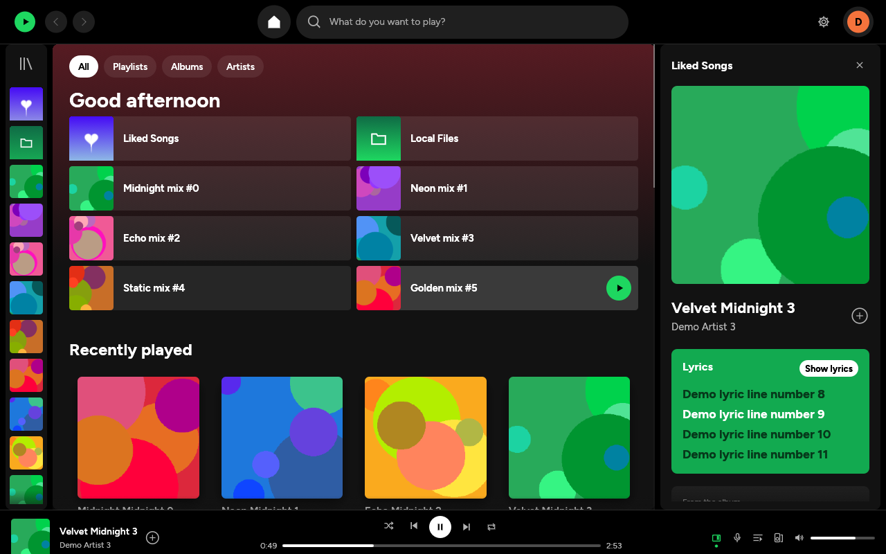
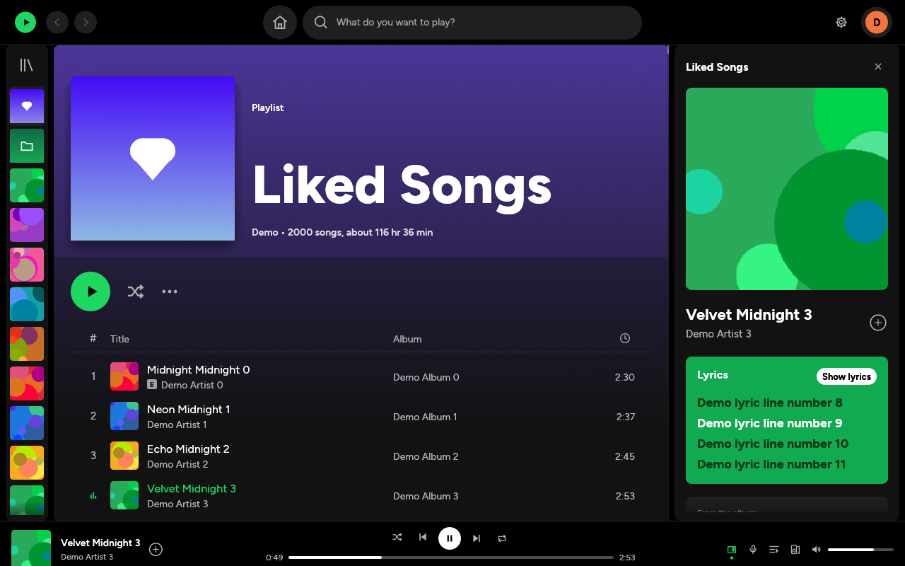
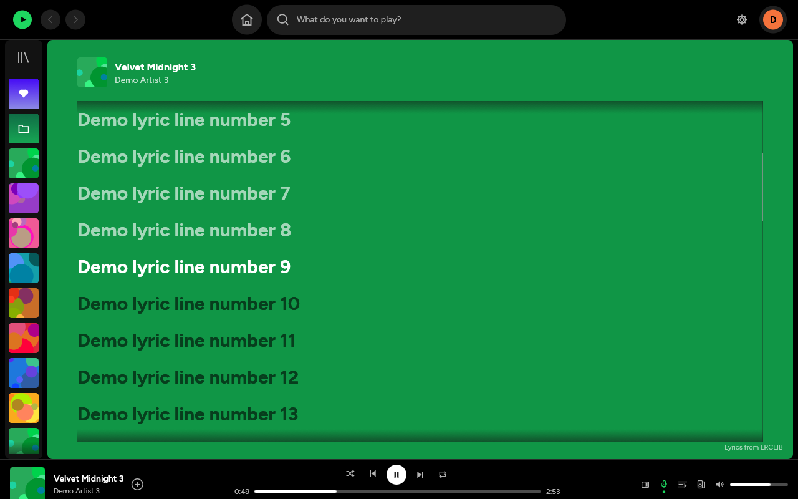

# Lumen

A lightweight, open-source music player written in Rust, with **Spotify Premium
streaming** and **independent playback without Premium**.
It uses [librespot](https://github.com/librespot-org/librespot) for playback and an
immediate-mode [egui](https://github.com/emilk/egui) UI (OpenGL; no Electron, no
persistent webview; verification opens WebView2 on Windows or a WebKitGTK helper
on Linux only when needed).

> **Unofficial.** Lumen is not affiliated with, endorsed by, or connected to Spotify AB.
> "Spotify" is a trademark of Spotify AB. Spotify streaming needs your own Premium account. Use Lumen at
> your own risk; third-party clients may break whenever Spotify changes its services.



| Playlist page | Full-screen lyrics |
|---|---|
|  |  |

*(Screenshots from `lumen --demo`, which uses generated sample data and covers.)*

## Downloads

Get the app from [GitHub Releases](https://github.com/zaydzaari/Lumen/releases).
For modern Linux Mint, Fedora, Arch and gaming desktops, choose the x86_64
`.flatpak` package. Ubuntu 24.04+ users can also choose the `.deb` installer.
See the Linux installation sections below for commands and requirements.

## Account sign-in and updates (0.1.1)

Choose **Continue with Spotify** to authorize read-only library access in your
browser. Lumen imports playlists it can read and Liked Songs into its native UI,
then uses independent playback. **Use Spotify Premium streaming** remains a
separate option. Saved metadata and completed downloads remain usable offline.
The Account settings include **Sync library** and **Log out**.

Lumen includes its registered public Client ID and uses PKCE, without a client
secret. Spotify development mode requires the app owner to have Premium and
accounts to be added under **User Management** in the developer dashboard (up to
five users). Playlist endpoints may only expose playlists the account owns or
collaborates on. Restricted lists are reported; public playlist links and account
JSON exports remain import options. Library sync is a read-only copy, not full
Spotify client parity. A real account login is required to verify your access.

Updates are checked at startup and every six hours, and matching stable-release
installers download in the background with size bounds and SHA-256 verification.
The app shows **Install update**; the normal Windows, Flatpak or Debian installer
completes installation. Portable Linux archives require extraction. Automatic
checks/downloads can be disabled in **Settings > Updates**. No music or credentials
are replaced. Windows now has a per-user setup installer with a Start menu shortcut.
Existing 0.1.0 installations need one manual upgrade to get this updater.

## Features

* **Spotify-style design**: black window with rounded panels, a collapsible "Your
  Library" sidebar (artwork rail or full list with Playlists/Albums/Artists chips), a
  top bar with back/forward, home, a search pill and your **profile picture menu**.
  The home page has quick-access tiles and card shelves. Playlist and album pages get
  a gradient header in the cover's own colour, a big play button and a track table.
  There's also a "Now playing" side panel, a queue panel, and full-screen lyrics on
  the album's colour. Text uses the bundled Figtree font, with Noto Kufi Arabic for
  Arabic titles.
* **Polish**: a frameless window with its own title bar (drag, double-click to
  maximise, minimise/maximise/close, resize from any edge; turn it off with
  `custom_title_bar = false`), a sticky mini-header with a play button when you scroll
  a playlist, "Search in Your Library" filtering, Spotify-style toggle switches in
  Settings, toast notifications and a restyled login screen.
* **Liked Songs state**: saved songs show Spotify's green check (track rows, player bar,
  Now playing); click it to remove. Every row has a hover **⋯** menu (play, queue, go
  to artist/album, save/remove, copy song link, open in Spotify). Hovering the seek bar
  shows the time under the pointer.
* **Your real profile**: your Spotify name and photo in the top bar, and a profile page
  (photo, followers, public playlists, recently played artists), straight from
  Spotify's profile service. No developer app needed.
* **Playlists**: create (**+ Create** in Your Library), rename and edit the description
  (click the title, or ⋯ → Edit details), delete, add songs (⋯ or right-click a song →
  Add to playlist) and remove songs from your own playlists.
* **Your Library like Spotify's**: right-click any playlist, album or artist for Play,
  Add to queue, Pin, Go to artist radio, Edit details, Delete / Remove from Your
  Library, Copy link and Open in Spotify. Pinned items stay on top; sort by Recents,
  Alphabetical, Creator or your own order — drag rows to rearrange them.
* **Drag and drop**: drag songs onto a playlist in the sidebar to add them, drag songs
  within your own playlist to reorder it, and drag songs in the queue.
* **Artist pages**: Follow / Following, a ⋯ menu (artist radio, copy link), "Fans also
  like" and an About card with the artist's photo and biography.
* **Home built around you**: Jump back in, Recently played, your top artists, "Your
  mixes" (one-click artist radio) and On repeat. Lumen fills these from what you play
  here, so they work without a developer app.
* **Playing like Spotify**: one click on anything in Your Library opens it, a
  double-click plays it; in the list view the play icon on its cover plays it too. Play buttons respect shuffle (a random
  first song when it's on), and turning shuffle on in a playlist that isn't playing
  starts it shuffled. Cards and Home tiles for what's playing keep a pause button, and
  clicking it pauses in place. Lumen reopens on the song you were listening to, paused
  where you left off.
* **The full song menu everywhere**: right-click a song in any list, the player bar
  (cover, title or artist), the Now playing panel (or its ⋯) or the queue for: Add to
  playlist, Remove from this playlist, Save / remove from Liked Songs, Add to queue,
  Go to song radio, Go to artist, Go to album, **View credits** (performers, writers,
  producers), **Share** (Copy Song Link, Copy Spotify URI, Embed track) and Open in
  Spotify app.
* **Save button like Spotify's**: "+" saves a song to Liked Songs; clicking the green ✓
  of a saved song opens "Add to playlist" with Liked Songs and your playlists to tick,
  a search box and New playlist, applied with Done.
* **Right-click any card** (Home, search, library pages, artist pages) for the same menu
  as in Your Library: play, add to queue, radio, **Add to / Remove from Your Library**
  (save albums, follow playlists and artists), copy link.
* **Now playing panel like Spotify's**: click "Playing from" to open that playlist,
  an **About the artist** card (photo, biography, Follow) and a **Credits** card.
* **Keyboard shortcuts overview**: `Ctrl+/` or ⋯ → Keyboard shortcuts. `Ctrl+K` also
  opens search.
* **Artist pages like Spotify's**: picture banner, Play / Shuffle / Follow, Popular
  (See more), your Liked Songs by the artist, Discography with Popular releases /
  Albums / Singles and EPs / Compilations, Fans also like, Appears On and About.
* **Album pages** end with the release date, copyright and "More by <artist>"; your own
  playlists end with **Recommended** songs (Add, Refresh).
* **Friend Activity** (people icon in the top bar) when Spotify shares it with Lumen.
* **Your Library "View as" Compact or List**, and **Volume level** (Loud / Normal /
  Quiet) when Normalize volume is on.
* See [PARITY.md](PARITY.md) for a feature-by-feature comparison with Spotify.
* **Find and sort in playlists**: the search icon in the action row (or `Ctrl+F`) filters
  the list; sort by Title, Artist, Album or Duration from the menu or by clicking the
  column headers (click again to reverse). Playing from a sorted or filtered list
  follows that order.
* **Select several songs**: `Ctrl`+click and `Shift`+click (or `Ctrl+A`) to select;
  right-click to add them all to the queue or a playlist, like/unlike them, or remove
  them from your playlist (`Delete` works too); drag them onto a playlist together.
* **Radio and autoplay**: Go to song/artist radio from any menu; when a playlist or
  album ends, similar songs keep playing (Settings → Audio → Autoplay).
* **Connect device picker** (speaker button in the player bar): see your other Spotify
  devices and move playback to your phone, TV or speaker. A green strip shows where
  music is playing.
* **Recent searches**: what you open or play from search shows up when the search box
  is empty, with × to forget one and "Clear recent searches".
* **Private session** (profile menu): nothing you play is recorded in your stats or
  shown on Discord; a blue lock sits on your avatar while it's on.
* **Mini player** (button next to full screen, or `Ctrl+Shift+M`): the window shrinks
  to a small always-on-top cover with controls. Double-click it or press Esc to go back.
* **Arabic and mixed text** read in the right order (right-to-left words, mirrored
  brackets) in titles, lists and lyrics.
* **Lyrics from Spotify first**: the same synced lyrics as the official app (Musixmatch).
  If Spotify has none, Lumen looks them up on LRCLIB. The lyrics view shows who
  provided them.
* **Instant pages**: playlists, albums and Liked Songs are saved on disk. Opening one
  shows the saved copy immediately while Lumen quietly checks Spotify for changes, and
  hovering a playlist for a moment starts loading it before you click. Your library
  sidebar appears straight away at startup.
* **Listening stats** (profile menu → Listening stats, or the button on your profile):
  minutes listened, plays, top artists, songs and albums, when you listen (by hour and
  weekday), the last 30 days and your streak, for 4 weeks / 6 months / all time.
  Recorded by Lumen on this computer; a song counts after 30 seconds, as on Spotify.
* **Settings** redesigned like Spotify's: clear rows with a short explanation, toggles
  and dropdowns on the right, jump-to-section chips and a settings search.
* **Themes (Spicetify-compatible)**: a built-in theme marketplace (palette button in
  the top bar) lists the official Spicetify themes and community themes from GitHub.
  Install with one click; hover a colour scheme to preview it live, click to apply, and
  the whole app cross-fades into it. Drop any Spicetify `color.ini` onto the window to
  import it. Lumen applies the themes' colour schemes; their CSS layout tweaks don't apply
  to a native app. See [Themes](#themes).
* **Full-screen mode** (F11 or the corner button in the player bar): blurred artwork
  backdrop, big cover and title, the current lyric line, and full controls.
* **Animations**: page fades, smooth hover states, Spotify's card play-button slide-up,
  an animated equaliser on the playing song, sliding side panel, lyric line transitions
  and theme cross-fades. Turn them off in Settings → Appearance.
* **Responsive layout**: on narrow windows the library folds into the artwork rail and
  the right panel slims down, so the main view always stays usable.
* **Discord Rich Presence** (custom): shows "Listening to …" on your Discord profile
  with the song, artist, album art, a progress bar and an "Open in Spotify" button.
  You use your own Discord application, so you choose the name, and the text lines are
  templates (`{title}`, `{artist}`, `{album}`). See [Discord status](#discord-status).
* **Login** through Spotify's own page in your browser (OAuth + PKCE). Credentials are
  stored in Windows Credential Manager / macOS Keychain / a private file on Linux.
  Lumen logs in automatically on the next launch, and there's a Log out button.
* **Library**: Home (recently played, top tracks, top artists), Search, Liked Songs,
  Playlists (paginated), Albums, Artists. Lists are virtualised, so thousands of tracks
  scroll smoothly.
* **Playback**: play/pause, next/previous, seek, volume, shuffle, repeat
  off/all/one, queue with add/remove/reorder, play from any list, gapless playback,
  volume normalisation, quality 96/160/320 kbps.
* **Local Files**: play your own MP3, FLAC, Ogg/Vorbis, Opus, M4A (AAC/ALAC)
  and WAV files without Spotify login or an internet connection. Folder scanning,
  title/artist/album filtering, queue actions, embedded covers and sibling `.lrc` lyrics.
* **Spotify Connect**: Lumen appears as a device in the phone/desktop apps and can be
  controlled from them.
* **Search** across tracks, albums, artists and playlists (results appear 350 ms after
  you stop typing).
* **Lyrics** from Spotify, with [LRCLIB](https://lrclib.net) as fallback. Synced lyrics highlight and auto-scroll
  with playback (click a line to seek). Falls back to plain lyrics, or shows "no lyrics
  found". Lyrics are cached on disk as small text files.
* **Streaming cache**: librespot's encrypted audio cache can reuse audio; authentication
  can still require internet. Default limit 2 GB with automatic eviction.
* **Permanent downloads**: played songs use SpotiDownloader with a locally saved
  token, or public-source matching without one. Completed tagged MP3s are kept in Music/Lumen
  Downloads and preferred for later playback through Lumen, including offline.
* **Album art**: smallest suitable size, downscaled before reaching the GPU, LRU memory
  cache (150 images by default) plus a size-capped disk cache. Big header/now-playing
  covers live in a separate small cache (64), so browsing doesn't pile up large textures.
* **Memory trimming** (Windows): when Lumen is idle for a minute, minimised or hidden
  to the tray, it hands unused memory pages back to Windows (`trim_memory = true`).
* **Plugins** in sandboxed Lua 5.4. See [PLUGINS.md](PLUGINS.md). Ships with a theme
  plugin and a "now playing to text file" plugin for streamers.
* **Themes**: dark (default) and light, configurable accent colour.
* **Media keys** / OS now-playing integration, **system tray** (Play/Pause, Next,
  Previous, Show, Quit) with optional minimise-to-tray.
* **Keyboard shortcuts** (configurable): `Space` play/pause, `Ctrl+→`/`Ctrl+←`
  next/previous, `Ctrl+L` search, `Ctrl+↑`/`Ctrl+↓` volume, `Ctrl+Q` quit, `F12` debug
  overlay (RSS memory + FPS). Fixed keys like Spotify's: `Alt+←`/`Alt+→` (and the mouse
  side buttons) back/forward, `↑`/`↓` select a song in a list and `Enter` plays it,
  `Ctrl+F` find in playlist, `Ctrl+A` select all, `Esc` clears the selection,
  `Alt+Shift+B` likes the current song, `Ctrl+Shift+M` mini player, `F11` full screen.
  On macOS `Ctrl` means `Cmd`.

## Requirements

* A **Spotify Premium** account for Spotify streaming. Local files and independent playback need no Spotify streaming account.
* *Optional:* your own Spotify **developer app client ID** for saved albums,
  followed artists, personalized history and saving songs through the Web API:
  1. Open <https://developer.spotify.com/dashboard> and log in.
  2. **Create app**. Any name and description work.
  3. Redirect URI: `http://127.0.0.1:8989/login` (exactly).
  4. Tick **Web API**, accept the terms, save.
  5. Copy the **Client ID** from the app's Settings into Lumen.

  Spotify requires the app owner to have Premium, and development-mode apps allow up to
  5 users, which is fine for personal use. Without a client ID, authenticated session
  browsing supports playlists, liked songs, track search, album/artist browsing and playback.

## Running

Download or build the binary (below) and start it. On first start:

1. Optionally paste your client ID, then click **Log in with Spotify**.
2. Your browser opens Spotify's login page. Approve it. Your playlists load automatically.
3. Done. Next time Lumen logs in by itself.

For optional Web API features, enter your developer client ID in **Settings** and
click **Connect full Spotify library**. Approve library access in the browser.
This additional authorization keeps the current track and queue playing.

The interface includes persistent search, cover cards on Home, a virtualized library,
vector transport controls, queue/lyrics panels and an expanded **Lyrics** page with
synced highlighting, automatic scrolling and click-to-seek. Lyrics coverage depends
on LRCLIB; use **Retry lyrics** after a temporary lookup failure.

**Permanent downloads:** playback starts a background job using SpotiDownloader when
its token is saved; without a token, Lumen finds a matching public recording on
YouTube, then SoundCloud if needed. Completed MP3s are saved in **Music → Lumen Downloads**, outside the
evicting cache. Files remain until you delete them. Later plays through Lumen's own
queue prefer the local file. **Local Files** also lists completed downloads and
works without Spotify login. In Premium streaming mode, the first play can stream while downloading; sources
do not switch mid-song. Opening/searching a playlist alone does not start downloads.

SpotiDownloader requires FFmpeg and a service token. Public-source matching also
requires yt-dlp and Node.js (already installed on the validated PC). Lumen
prefers its complete official yt-dlp helper in the app data tools folder when present.
Settings → Storage includes automatic saving, folder access, status and Retry song.
Disabling automatic saving keeps existing files. Private sessions do not schedule
downloads. Set `[downloads].folder` in config.toml to change the folder after restart.
Matching is heuristic: a different version/quality can be selected, a song may have
no match, or a source may require sign-in. SoundCloud previews and wrong-duration
recordings are rejected. YouTube auth/rate-limit failures pause that provider for
30 minutes while public SoundCloud remains available. Failures produce a short
message; detailed helper errors go to the logs rather than filling the player.
Browser cookies are not read automatically. Phone-driven Spotify Connect still
streams. The SpotiDownloader service's upstream audio source is not verified.

**Attended download verification (Windows and Linux):** play a song, or choose **Settings →
Storage → SpotiDownloader connection → Connect**. Lumen loads the provider's real
page in a small WebView2 panel (Windows) or WebKitGTK window (Linux), showing its existing Cloudflare widget. Complete
verification yourself if asked. The session is handed back automatically, the panel
closes, and the pending background download resumes. No token copying or Chrome
window is needed. The Windows WebView2 runtime must be installed (it is present on
the validated PC). Linux uses system WebKitGTK 4.1. Lumen's main interface remains native egui.

The web engine is created only during verification and released on success, Cancel,
timeout or application exit. It uses an isolated profile in Lumen's app-data folder,
with no personal Chrome/Edge profile, extensions, popups, media autoplay, file
downloads, browser menus or autofill. Network requests are restricted to the provider
and Cloudflare; third-party ad/tracking hosts are blocked. The provider's widget
remains intact; only the surrounding page presentation is reduced. **Show page**
is available if the site layout changes or the widget is blank.

Expiry is checked only when a song needs downloading, not on a periodic browser
timer. A rejected session gets one attended reconnection attempt per job. Playback
continues while waiting; Cancel abandons that job. **Disconnect** removes the saved
token and disables automatic browser verification, restoring public-source matching.
Set `[downloads].browser_connection = false` for the same behavior. macOS
retains the manual token workflow. Cloudflare can reject embedded browsers, so live
verification is subject to the provider's current browser support and challenge.

**Manual token fallback:** under **Advanced: manual download token**, paste the
Authorization Bearer value from the site's successful `/download` request in your
browser's Developer Tools. The `Bearer ` prefix is optional. Do not paste cookies
or a Spotify login token. Lumen does not skip or automatically solve CAPTCHAs.

Tokens are stored in Lumen's existing local secret store (OS credential manager
where available, otherwise the app-data secrets folder), never in config.toml or
the download library. Secret files are ignored by Git, including portable installs.
The manual field clears after Save; saved tokens are never displayed. Manually
replaced tokens apply to the next job without restarting. When reconnection fails,
Lumen reports the failure rather than silently substituting another recording.
Use **Retry song** after reconnecting if you cancelled a previous attempt. Live
service availability and session lifetime are controlled by SpotiDownloader.

For your own music, choose **Listen to local files without logging in**, then
**Settings → Local music folders**. Enter a folder path and click **Add folder**;
remove folders or use **Rescan** there. The **Local Files** sidebar lists the tracks.
Click a row to play; right-click for play/queue actions. The existing queue, seek,
volume, shuffle and repeat controls work for local files too.

```toml
[local]
folders = ['C:\Music', 'D:\Albums']
scan_on_start = true
```

The compact `cache/local-index.json` index is refreshed on a blocking thread; only
files with changed modification time or size are reparsed. Deleted files disappear
on rescan. Scans do not follow symlinks and are limited to 20,000 files; oversized or
corrupt tags are reported. Cover art is read on demand through the capped ArtCache.
Sibling `.lrc` files take priority over LRCLIB and work offline; cached LRCLIB lyrics
also work offline. New LRCLIB lookups need internet access.

If Spotify is unreachable at startup, Lumen opens Local Files and reports
“Offline — Spotify features unavailable”. It checks connectivity every 30 seconds
and retries saved-login authorization in the background. A successful login retains
the current local track and queue. Without saved credentials, use the sidebar login
button when ready. Offline support is exclusively for your own files: no Spotify
audio export, recording, decryption or decryption-key storage is added.

## Building

All platforms need Rust stable (at least 1.95, required by egui 0.36.2) and CMake
(used to build bundled libopus). The build scripts install Rust with rustup if missing.
The scripts run `cargo build --release --locked` and copy the binary to `dist/`.

### Windows

1. Install the *Visual Studio 2022 Build Tools* (or a newer MSVC toolset) with the C++ workload and recommended CMake tools:
   `winget install Microsoft.VisualStudio.2022.BuildTools --override "--quiet --add Microsoft.VisualStudio.Workload.VCTools --includeRecommended"`
2. In PowerShell, in this folder: `powershell -ExecutionPolicy Bypass -File .\build.ps1`
3. Run `dist\lumen.exe`.

The script discovers Visual Studio's bundled CMake automatically. In a restricted
Windows environment where `lib.exe` reports LNK1114/access denied, install
`rustup component add llvm-tools`; the script automatically uses `llvm-ar` when present.

### macOS

```sh
xcode-select --install   # once
# Install CMake using your preferred package manager.
./build.sh
./dist/lumen
```

### Linux

```sh
# Debian/Ubuntu
sudo apt install build-essential cmake pkg-config libasound2-dev libgtk-3-dev \
  libayatana-appindicator3-dev libxdo-dev libxkbcommon-dev libxkbcommon-x11-0 libgl1-mesa-dev libwebkit2gtk-4.1-dev libssl-dev ffmpeg
# Fedora
sudo dnf install cmake alsa-lib-devel gtk3-devel libayatana-appindicator-gtk3-devel \
  libxkbcommon-devel mesa-libGL-devel webkit2gtk4.1-devel openssl-devel ffmpeg

./build.sh
./dist/lumen
```

To build without the tray icon (avoids AppIndicator; GTK/WebKitGTK remain required for verification):
`cargo build --release --locked --no-default-features --features media-controls`.

### Development

```sh
cargo test                     # unit tests
cargo clippy -- -D warnings
cargo fmt
LUMEN_LOG=debug cargo run      # verbose logging
LUMEN_HOME=/tmp/lumen cargo run   # portable mode: all files under one folder
```

The synthetic fixtures in `tests/fixtures` cover all six local formats; tests do not
need Spotify, network access or an audio device. An additional device test is opt-in:
`cargo test local_audio_device_play_pause_seek_and_next -- --ignored` (zero volume).

## Files

| What                 | Windows                                  | macOS                                          | Linux                     |
|----------------------|------------------------------------------|------------------------------------------------|---------------------------|
| `config.toml`, plugins | `%APPDATA%\lumen\Lumen\config\`          | `~/Library/Application Support/dev.lumen.Lumen/` | `~/.config/lumen/`        |
| logs (daily, 5 kept), plugin data | `%LOCALAPPDATA%\lumen\Lumen\data\` | `~/Library/Application Support/dev.lumen.Lumen/` | `~/.local/share/lumen/`   |
| audio / art / lyrics cache | `%LOCALAPPDATA%\lumen\Lumen\cache\`  | `~/Library/Caches/dev.lumen.Lumen/`             | `~/.cache/lumen/`         |

Everything in `config.toml` is documented by its defaults (it is written on first run):
audio quality, normalisation, gapless, volume, cache sizes, theme, accent, tray,
shortcuts (`"Ctrl+Right"` style), disabled plugins, Connect device name, client ID.

## Memory and performance (measured)

**Third pass, stress test** (Linux release build, no GPU so Mesa's software renderer
is loaded; demo mode with 2 000 songs and 400 different covers; scrolling the whole
Liked Songs table, then Home, then search): **167 MB at start, 182 MB peak, flat at
182 MB idle afterwards.** Roughly 64 MB of that is the software rasteriser, which a
real GPU replaces with its driver. On Windows the idle trimming (see Features) also
returns unused pages after a minute without input or when minimised. Press **F12**
for the live number on your machine.

Windows 11, native MSVC release build, NVIDIA GeForce RTX 5070, 2026-10-16:
**168.0 MiB idle RSS with the redesigned window visible and session browsing**
(working set after 25 seconds settling plus a 10-second sample; existing user
config, saved Spotify login, tray and media controls enabled). CPU time increased
by **0 ms over the 10-second idle sample** at Windows process-timer resolution.
Measured through the Windows process API. The window remained alive, saved-account
authentication succeeded and the new launch logged no warnings or errors. Screenshot
capture/F12 interaction was blocked because Computer Use was not approved for Lumen;
visual appearance has not been verified through automation.
Release executable: 17.4 MiB. Rust 1.99.1, MSVC 14.50, locked dependencies.
An earlier hidden launch of this redesign used 102.4 MiB; prior library-recovery
build used 99.8 MiB, Local Files build 162.9 MiB, and baseline 137.2 MiB. Window
visibility, configuration, loaded artwork and driver working sets differ, so these
runs are not a controlled performance comparison and do not demonstrate a speedup.

Release build, Linux x86_64 (Ubuntu 24.04 VM, 2 vCPUs), measured with `/proc/<pid>`
after 8–10 s idle, 4 runs:

| Measurement | Result |
|---|---|
| Binary size (stripped) | 22 MB |
| Time to window | 0.10 s warm (0.56 s first, cold disk cache) |
| Idle RSS, total | **143–148 MB** (varies per run) |
| … of which software OpenGL (Mesa llvmpipe: libLLVM + gallium) | 64 MB |
| … of which GTK tray icon (Linux only) | ~11 MB |
| Idle RSS minus the software rasteriser | **~79–84 MB** (≈68 MB with tray disabled) |
| Threads | 14 (10 without tray) |
| Idle CPU | 0% (no repaint without input or events) |

**Notes:**

* The test VM has **no GPU**, so Mesa's software renderer (llvmpipe) loads LLVM into
  the process. That alone costs 64 MB and inflates the total. On a machine with a GPU
  the driver's footprint replaces it and differs per vendor. Press **F12** in Lumen to
  see the real RSS on your machine.
* **Playing memory was not measured**: there was no Spotify account and no audio
  device in the build environment. The design keeps playback lean: one decoder at a
  time, librespot's streaming buffers, and an audio device that is opened only while
  sound plays (`LazySink`). Use the F12 overlay to check it against the 130 MB target.
* Result vs targets: the app's own share is right around the 80 MB idle target (just over with the tray, under without it), and the total is
  over it on a GPU-less machine. A profile showed nothing else large to trim:
  arena tuning (`MALLOC_ARENA_MAX`) changed nothing, plugins cost <1 MB, the heap is
  ~20 MB (fonts, egui, TLS roots, runtime) and code pages are 13 MB.

## Themes

Open the **palette button** in the top bar (or Settings → Appearance → Browse themes).

* **Marketplace**: the same themes as the Spicetify Marketplace: everything in
  [spicetify/spicetify-themes](https://github.com/spicetify/spicetify-themes) plus
  GitHub repositories tagged `spicetify-themes` (the Marketplace's blacklist is
  respected). The list is cached for 12 hours; the ↻ button refreshes it.
* **Install** downloads only the theme's `color.ini` (a few KB) and applies its first
  scheme. Installed themes live in your config folder under `themes/`.
* **Colour schemes**: most themes ship several (Sleek has 19, *text* has 24). Hover one
  to preview it across the whole app, click to keep it.
* **Import**: drag a `color.ini` file onto the Lumen window.
* **Back to normal**: pick *Spotify (default)*, or *Dark*/*Light* in Settings.

Lumen maps Spicetify's colour keys onto its own palette (`main` → main view,
`sidebar` → library, `player` → window/player bar, `card` → raised surfaces,
`text`/`subtext`, `button`/`play-button` → accent, `notification*` → toasts). If a theme
uses one of those keys as a highlight colour that text can't be read on, Lumen keeps a
readable background instead. Themes that only change CSS (no `color.ini`) can't be
installed.

## Discord status

1. Open <https://discord.com/developers/applications> and click **New Application**.
   The name you give it is what Discord shows: "Listening to **<name>**". For example
   "Spotify", "Lumen" or "Zayd's Music".
2. Copy the **Application ID** from *General Information*.
3. In Lumen: **Settings → Discord status**, paste the ID, and keep the Discord desktop
   app running.

Options: first/second line templates (`{title}`, `{artist}`, `{album}`), album-art
tooltip, album art on/off, progress bar on/off, "Open in Spotify" button, and keeping
the status while paused. Album art works without uploading anything (Discord loads
Spotify's cover URL). Local files show text only. Lumen reconnects automatically if
Discord restarts, and only sends updates when the song or play state changes.

## Plugins

See [PLUGINS.md](PLUGINS.md) for the full Lua API (events `track_change` / `play` /
`pause`, current track, commands, notifications, theme colours, sandboxed files) and
the two example plugins.

## Known limitations

* Local transitions reopen the audio device; sample-accurate gapless local playback
  and Spotify loudness normalization are not implemented for local files.
* Windows UI inspection/F12 automation was blocked during verification; the recorded
  RSS measurement uses the Windows process working set. Saved-login authentication,
  playlist and liked-song pagination, search, album lookup, artwork fallback, lyrics
  lookup and muted Spotify playback were subsequently verified with a live session.
  Phone-controlled Connect playback and optional developer-app authorization remain
  unverified interactively.
* Following artists, saving albums, playlist edits, radio and moving playback to
  another device use Spotify's internal services (the same ones the official app
  uses). They were written against the protocol but not tested against a live
  account from the build environment; if one fails you get a clear message.
* **Private session** is Lumen-side: it stops Lumen's own history and Discord status.
  Spotify's server-side private session can't be switched on through librespot, so
  Spotify may still use these plays for its recommendations.
* **Download coverage** depends on matching and source availability. Completed MP3s
  play offline through Lumen's queue or Local Files; uncached songs need internet.
* Some library features require the optional developer-app authorization described
  above. Session browsing uses librespot metadata/context endpoints; those can change
  independently of the public Web API. Public Web API rate limits are respected with
  a shared cooldown and visible errors, without repeating requests every 30 seconds.
* **Spotify Web API development-mode limits** (Feb 2026): search returns 10 results per
  type; tracks of playlists you don't own are loaded through librespot instead, with
  metadata filled in as you scroll; artist pages show "popular" tracks via librespot.
* **Spotify Connect**: Lumen can be controlled from your phone. While Lumen plays from
  its *own* queue, though, the phone doesn't show Lumen as the active device. Queue
  editing is only available for local playback.
* Audio-cache size changes, tray on/off and Connect device name apply after a restart.
* Linux tray needs a StatusNotifier/AppIndicator host (GNOME needs the AppIndicator
  extension). Media keys on Linux need a D-Bus session bus.
* Lyrics come from the community LRCLIB database; coverage varies.
* The Windows build is driven by `build.ps1` but was not compiled in the Linux
  environment Lumen was developed in (see DECISIONS.md).

## License

MIT, see [LICENSE](LICENSE). Design notes are in [DECISIONS.md](DECISIONS.md).

### Desktop layout

Home now has compact shortcuts and cover shelves, a collapsible artwork library,
and a Now Playing panel. Click the library icon to expand titles; click a playlist
cover to open it. The player offers queue, lyrics, seek, volume and mute controls;
click the current cover to show or hide Now Playing. Seek/volume support keyboard
arrows and Home/End when focused. Library width preference is saved automatically.
Artwork is requested only for visible cards and rows; scrolling keeps the existing
bounded texture cache and background decoding.

## Credits

Fonts bundled in `assets/fonts/` under the SIL Open Font License 1.1 (licence texts
included): [Figtree](https://github.com/erikdkennedy/figtree) and
[Noto Kufi Arabic](https://github.com/notofonts/arabic).


## Playback without Spotify Premium

Choose **Continue without Premium** at login, or enable **Settings > Storage >
Playback without Premium**. This is independent audio playback: it does not open
librespot's Spotify streaming session, which requires Premium.

- In **Settings > Storage > Import Spotify playlists**, paste a Spotify track,
  album, or public playlist URL and click **Import**. This uses the existing
  SpotiDownloader connection; complete its CAPTCHA in Lumen if prompted.
- For personal/private library data, request Spotify's account-data export at
  https://www.spotify.com/account/privacy/, extract it, and import each
  `Playlist*.json` or `YourLibrary.json` file. A path can be pasted into the same
  field, or a JSON file dropped onto the window. Reimporting updates matching
  playlists. Unsupported podcast/local-file entries are counted and skipped.
- Imported playlists appear in Your Library. Search searches imported tracks and
  local music (up to 500 results), rather than Spotify's entire online catalogue.
- Play requests download missing audio first, then play the completed file from
  the permanent music folder. First playback must wait for the download; later
  playback is local and works offline. Queue, shuffle, repeat, seeking, volume,
  media controls, local history, and available LRCLIB lyrics still work.
- Only requested songs download. Importing a playlist does not download it in
  bulk. Explicit playback downloads work even if background automatic saving is
  switched off. Failed songs stay selected for retry rather than downloading the
  entire upcoming queue.

Provider availability, recording identity and catalogue coverage are not
guaranteed. JSON exports often omit duration: Lumen measures completed provider
audio and stores the duration; public title/artist matching still requires a
known reference duration. No Premium playback restriction or Spotify DRM is
removed. Live account sync, Spotify Connect, private playlist access and Spotify
library edits are not provided by independent mode. Link-import metadata follows
the provider's current frontend API contract and requires a real attended-session
check; fixture tests do not prove its live availability.


## Linux installation and verification

Linux builds support the native eframe UI, local/offline audio, independent
playback, imports, LRCLIB lyrics, D-Bus media keys and the optional AppIndicator
tray. The small attended verification window uses system WebKitGTK 4.1, with no
bundled Chromium. It runs in a separate, short-lived Lumen process so GTK does
not compete with eframe or the tray thread. It works with GTK's X11 and Wayland
backends. Popups, media, permissions, downloads and other network origins are
blocked. CAPTCHA interaction is manual; provider acceptance of WebKitGTK still
needs a real-session check. The manual token option remains available.

On Ubuntu 24.04 or newer, install the `.deb` from GitHub Releases using:

```sh
sudo apt install ./lumen_0.1.1_amd64.deb
lumen
```

The portable tarball contains `lumen`, an optional user-local `install.sh`, the
application icon/desktop entry, licence and example plugins. It still needs the
system GTK/WebKitGTK/audio libraries; it is not a static or universal AppImage.
Run `./install.sh` to install under `~/.local`, or pass an installation prefix.
Make sure `~/.local/bin` is on PATH. FFmpeg is required for new audio downloads;
yt-dlp/Node are only needed for the optional public-source matching fallback.
Do not run the desktop application as root or disable WebKit's sandbox.

To build from source on Ubuntu:

```sh
sudo apt update
sudo apt install build-essential pkg-config cmake libasound2-dev libgtk-3-dev \
  libayatana-appindicator3-dev libxdo-dev libxkbcommon-dev libxkbcommon-x11-0 libgl1-mesa-dev \
  libwebkit2gtk-4.1-dev libssl-dev ffmpeg
bash build.sh
```

`packaging/linux/package.sh` creates a tarball and, where `dpkg-deb` is present,
a Debian package. GitHub Actions builds the Linux release on Ubuntu 24.04 for a
broader runtime baseline and tests Windows separately. Library files and browser
profiles stay in the user's XDG data folders; secrets use private files on Linux
and are excluded from Git. Private accounts/downloaded music are never included
in release archives.


### Flatpak for Mint, Fedora, Arch and gaming desktops

Use the `.flatpak` release download for modern x86_64 distributions with Flatpak
support, including Linux Mint and gaming desktops such as SteamOS/Bazzite:

```sh
flatpak install --user ./lumen-0.1.1-linux-x86_64.flatpak
flatpak run io.github.zaydzaari.Lumen
```

Flatpak may download its shared GNOME runtime on first installation. That runtime
provides GTK/WebKitGTK and FFmpeg, so separate distro packages are not needed.
This build includes media keys and the normal player, with the optional tray icon
omitted to avoid depending on a host AppIndicator installation. It grants network,
graphics/audio, and home-folder access for your music/imports; application settings
remain in Flatpak's per-app directory. Live provider verification still needs a
human check. This package is for x86_64, not ARM or every historical Linux version.
